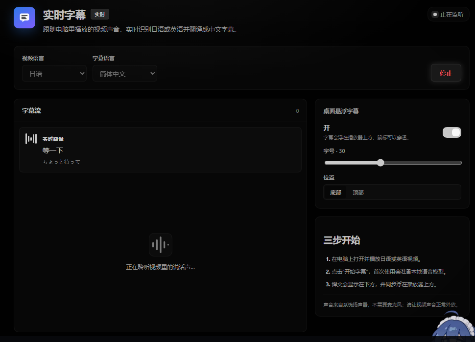

# 实时字幕 / Live Subtitles

一个 [DeepSeek Harness](https://github.com/deepseek-ai) 插件：在电脑本地播放日语或英语视频时，从系统扬声器捕获声音，边说话边识别、边翻译并显示中文字幕，同时提供可穿透点击的桌面悬浮层。



## 安装

要求：Windows 10/11、DeepSeek Harness（含 `speech-to-text` 实验性语音识别与翻译能力）、Python 3.10+。

### 方式一：插件市场（推荐）

在 DeepSeek Harness 中打开「插件市场」，添加 GitHub 仓库来源：

```
Oreo0614/dsh-realtime-subtitles
```

然后点击安装并重启 Harness。

### 方式二：命令行

```bash
dsh plugin add github:Oreo0614/dsh-realtime-subtitles
```

安装完成后重启 DeepSeek Harness，左侧栏会出现「实时字幕」入口。

> 升级：用同样的命令重新安装一次即可；插件市场里也会提示更新。

## 使用

1. 在电脑上打开并播放日语或英语视频，保持声音外放。
2. 点击左侧栏的「实时字幕」，选择视频语言，然后点击「开始字幕」。
3. 首次启动会准备本地 Whisper 模型（tiny + base，约 220 MB），之后复用缓存。
4. 正在说话时先用 tiny 模型生成滚动草稿并立即翻译；停顿约 270 ms 后用 base 模型给出一句完整、准确的字幕。
5. 桌面悬浮字幕默认开启，可在右侧面板关闭、调整字号和位置；悬浮层鼠标穿透，不挡播放器操作。

## 依赖

- Python 3.10+，以及 `soundcard`、`numpy`、`faster-whisper==1.2.1`、`ctranslate2==4.5.0`；首次启动会尝试自动安装缺失组件。
- 本地识别模型来自 `Systran/faster-whisper-tiny` 与 `Systran/faster-whisper-base`，通过 HF-Mirror 下载到 `$DSH_HOME/realtime-subtitles/faster-whisper/`。
- Windows 上会为子进程设置 `KMP_DUPLICATE_LIB_OK=TRUE`，以兼容 Anaconda 的 MKL 与 ctranslate2 的 OpenMP 运行时。
- 翻译使用 Harness 自带的翻译服务（`@deepseek-ai/dsh-experimental-translator`，默认 Bing）。

## 低延迟设计

- **边说边出字**：每约 360 ms 提交一次短音频草稿，tiny 模型单次识别约 0.2 秒。
- **草稿即时翻译**：识别到草稿就请求翻译，悬浮层用同一行不断替换/补全，不等整句结束。
- **最终结果优先**：检测到语音结束时，丢弃排队中的旧草稿，final 请求插队，避免「上一句占着队列」。
- **双模型分工**：草稿用 tiny，最终句用 base；兼顾即时性和准确性。
- **短停顿切句**：静音约 270 ms 即结束当前句；连续讲话最长约 3.5 秒强制切分一次。
- **译文防抖**：草稿译文只增长不缩短，避免在多个不完整识别结果之间闪烁；最终译文会覆盖草稿。

## 实现

- `engine/engine.py`：WASAPI loopback 采集（`soundcard`）、WebRTC VAD 分段、faster-whisper tiny/base 识别、Tk 置顶穿透字幕层。
- `index.js`：Host 插件。启动/停止 Python 引擎，调用 Harness `translator` 翻译草稿和最终稿，通过同源 HTTP + SSE 向 Web 面板推送状态。
- `client.js`：左侧栏图标、主面板页面、实时字幕流和悬浮层设置。
- `cordis.patch.yml`：挂载匿名翻译服务，以及插件兼容的本地语音识别运行时。

## 说明与限制

- 目前针对日语和英语优化，目标是简体中文字幕；也支持「自动检测」。
- 草稿可能包含少量识别误差，停顿后的最终句会纠正；快速对白中请以最终句为准。
- 如果播放器使用 WASAPI 独占模式，系统回环可能采集不到声音，请改为共享模式输出。
- 仅支持 Windows（依赖 WASAPI loopback 与 Tk 悬浮窗）；识别在 CPU 上运行，低配机器上延迟会上升。

## English

A DeepSeek Harness plugin for live Chinese subtitles while playing Japanese or English videos locally: it captures system audio (WASAPI loopback), transcribes with a local faster-whisper tiny/base pipeline, translates through the Harness translator service, and renders both an in-app panel and a click-through desktop overlay.

Install:

```bash
dsh plugin add github:Oreo0614/dsh-realtime-subtitles
```

or add `Oreo0614/dsh-realtime-subtitles` as a GitHub source in the DSH plugin market. Requires Windows, Python 3.10+, and a DeepSeek Harness build that ships the `speech-to-text` and `translator` capabilities.

## License

[MIT](LICENSE)
